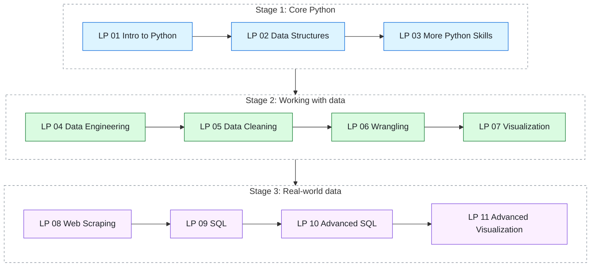
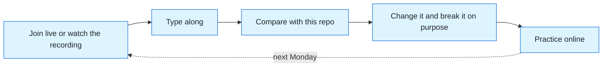
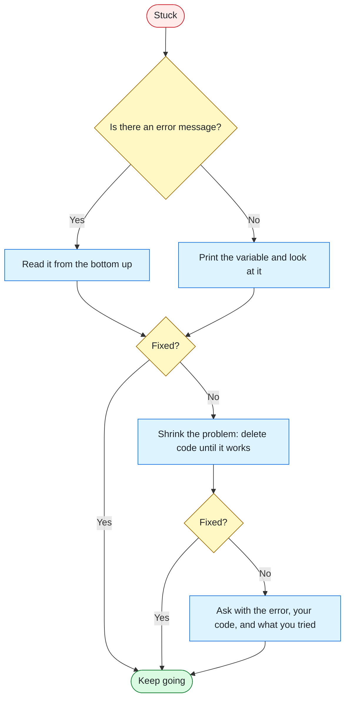

# Python Fall 26 Code-Alongs

Weekly live code-alongs for Code the Dream's Intro to Python, taught every Monday at 8:00 PM Eastern. Clone it, run it, break it, fix it, repeat.

[](https://www.python.org/downloads/)
[](LICENSE)
[](#the-monday-session)
[](https://www.youtube.com/@EricHunterPetross)

## Start Here

New to coding? You are in the right place. No experience is needed, and every question is a good question.

| | What | Where |
|---|------|-------|
| 🎮 | **Practice online** (pinned: keep your skills sharp between classes) | [Python Essentials: Bridge the Dream](https://straydogsyn.github.io/Python-Essentials-Bridge-The-Dream/) |
| 🎥 | **Watch the recordings** | [Eric Hunter Petross on YouTube](https://www.youtube.com/@EricHunterPetross) |
| ⏰ | **Join the live class** | Mondays, 8:00 PM Eastern |
| 🖥️ | **Review the slides** (interactive decks for self-study) | [Week 1: Learn the Controls](week01/week01-slides.html) · [Week 2: Save Points](week02/week02-slides.html) |
| 🏫 | **About the program** | [Code the Dream](https://codethedream.org/) |

**Your first move:** jump to [Getting Started](#getting-started) and get your computer ready. It takes about 15 minutes.

## Contents

- [What This Repo Is](#what-this-repo-is)
- [The Monday Session](#the-monday-session)
- [Who Can Use This](#who-can-use-this)
- [The Roadmap](#the-roadmap)
- [Getting Started](#getting-started)
- [How a Code-Along Works](#how-a-code-along-works)
- [Repository Layout](#repository-layout)
- [The Dad Joke Vault](#the-dad-joke-vault)
- [Getting Unstuck](#getting-unstuck)
- [Credits](#credits)
- [License](#license)

## What This Repo Is

Every week, I code live while you code with me. This repository holds the finished code from each session, so you have something to check your work against, something to study when a recording runs long, and something to fork when you want to take an idea somewhere I did not.

Think of it like a Blockbuster rental in reverse: be kind, **do not** rewind. Write your own version first, then compare. The difference between your code and mine is where the learning lives.

> 🧓 **Dad joke drop #1:** Why did the Python programmer wear glasses to the interview? Because they could not C. *(Hang onto this one. It lands when you meet your first non-Python language.)*

## The Monday Session

This repository is for **all Code the Dream students**, whatever your cohort and wherever you are in the program. Every file here is yours to use.

It is also tied directly to one live class:

| Detail | Info |
|--------|------|
| **Class** | Python Intro, Fall 26 |
| **Instructor** | Hunter (Eric Petross) |
| **When** | Mondays at 8:00 PM Eastern Time |
| **Format** | Live code-along, with recordings on [YouTube](https://www.youtube.com/@EricHunterPetross) |
| **Where** | Check your Code the Dream cohort announcements for the session link |

If you can make it live, come and bring questions. If Monday night is not your night, the recordings and this repo have you covered. The code in each folder matches what we build on screen, in the same order.

<details>
<summary>🌎 Time zone cheat sheet</summary>

| Your zone | Class starts |
|-----------|--------------|
| Eastern | 8:00 PM |
| Central | 7:00 PM |
| Mountain | 6:00 PM |
| Pacific | 5:00 PM |

The class is pinned to Eastern clock time, so daylight saving changes elsewhere can shift your local start by an hour.

</details>

## Who Can Use This

- 🎓 **Monday 8:00 PM ET students:** this is your home base. Each week's code lands here after the session.
- 🤝 **Any other Code the Dream student:** welcome. Preview an upcoming lesson packet, catch up on one you missed, or get a second explanation of a concept that did not click the first time.
- 🔮 **Future students:** this repo is public so the recordings always have their matching code. Fork away.

## The Roadmap

The lesson packets (LPs) follow the Code the Dream Python Essentials sequence. Each one gets its own folder here as we reach it.

The diagram shows the journey in three stages: core Python first, then working with data, then real-world data sources.



| LP | Topic | What you will learn |
|----|-------|---------------------|
| 01 | Intro to Python | Variables, data types, control flow, functions, debugging |
| 02 | Data Structures & File Handling | Lists, dictionaries, tuples, sets, reading and writing files |
| 03 | More Python Skills | Classes, comprehensions, decorators, closures |
| 04 | Intro to Data Engineering | Pandas basics, Series, DataFrames |
| 05 | Data Cleaning & Validation | Fixing messy data before it fixes you |
| 06 | Data Wrangling & Aggregation | Grouping, merging, summarizing |
| 07 | Intro to Data Visualization | Charts that tell the truth |
| 08 | Intro to Web Scraping | Requests, parsing HTML |
| 09 | Databases & SQL | Querying data with SQLite |
| 10 | Advanced SQL & Database Integration | Python and SQL working together |
| 11 | Advanced Data Visualization | Putting the whole toolkit to work |

**Good to know:** the order can flex with how the class is moving, and Monday's session is the source of truth. The [practice site](https://straydogsyn.github.io/Python-Essentials-Bridge-The-Dream/) follows the previous cohort's week order, which differs from this list after LP 04. Use it by topic rather than by week number.

> 🧓 **Dad joke drop #2:** I would tell you a joke about an infinite loop, but you would just keep asking for another one.

## Getting Started

You need three free tools: [Python 3.10 or newer](https://www.python.org/downloads/), [Git](https://git-scm.com/downloads), and [Visual Studio Code](https://code.visualstudio.com/). Install them, then follow the steps below.

<details>
<summary>🖥️ Never used a terminal? Start here</summary>

A terminal is a text window where you type commands instead of clicking buttons. The easiest way to open one:

1. Open Visual Studio Code.
2. Choose **Terminal**, then **New Terminal** from the top menu.
3. A panel opens at the bottom of the window. That is your terminal.

Type a command, press **Enter**, and read what comes back. You cannot hurt anything by trying.

</details>

### 1. Clone the repository

```bash
git clone https://github.com/StrayDogSyn/python-fall26-code-alongs.git
cd python-fall26-code-alongs
```

### 2. Create a virtual environment

A virtual environment is a clean room for your project's packages. Without one, every project shares a single junk drawer, and sooner or later two projects want different versions of the same thing.

Windows (PowerShell):

```powershell
python -m venv venv
venv\Scripts\Activate.ps1
```

macOS or Linux:

```bash
python3 -m venv venv
source venv/bin/activate
```

When it works, your terminal prompt starts with `(venv)`. That is your cue that the clean room is open for business.

### 3. Check your setup

```bash
python --version
git --version
```

You should see Python 3.10 or higher. On macOS or Linux, use `python3 --version` if `python` is not found.

### 4. Run your first line of Python

```bash
python -c "print('Hello, Fall 26!')"
```

If you see `Hello, Fall 26!` printed back, you are officially ready for Monday. 🎉

<details>
<summary>🛠️ Something went wrong? Common fixes</summary>

| Symptom | Likely fix |
|---------|-----------|
| `python` is not recognized | Try `python3` or `py`. If neither works, reinstall Python and check **Add Python to PATH** during setup |
| `git` is not recognized | Install Git, then close and reopen your terminal |
| PowerShell blocks the activate script | Run `Set-ExecutionPolicy -Scope CurrentUser RemoteSigned`, then try again |
| No `(venv)` in the prompt | Run the activate command again from inside the project folder |
| `ModuleNotFoundError` | Your virtual environment is probably not active. Activate it, then reinstall the package |

Still stuck? Bring it to Monday night, or see [Getting Unstuck](#getting-unstuck).

</details>

> 🧓 **Dad joke drop #3:** There are 10 kinds of people in this world: those who understand binary and those who do not. *(Come back after we cover how computers count. Yes, it is a joke about counting.)*

## How a Code-Along Works

Good news: there is no secret trick. There is a loop, and the loop works.



1. **Before class (optional, 10 minutes):** skim the lesson packet. You do not need to understand it, only to have seen the vocabulary once, like previewing the menu before the restaurant gets loud.
2. **During class:** type along with me. Do not copy and paste. Your fingers learn things your eyes skip.
3. **After class:** open the matching folder here and compare your code with mine.
4. **Mess with it:** change a value, rename a variable, break something on purpose, then read the error message. Error messages are the one teacher that is always honest with you.
5. **Practice:** work through the same topic on the [practice site](https://straydogsyn.github.io/Python-Essentials-Bridge-The-Dream/) for extra reps.
6. **Save your work:** commit your version to your own fork. Future you will say thanks.

**Using the recordings well:** pause often and try the next step yourself before I show it. Keep the matching repo folder open in a second window. Watch at normal speed the first time and speed up when reviewing. Everything lives on the [YouTube channel](https://www.youtube.com/@EricHunterPetross).

> 🧓 **Dad joke drop #4:** A programmer's partner says, "Go to the store and get a gallon of milk. If they have eggs, get a dozen." The programmer comes home with 12 gallons of milk. "They had eggs."

## Repository Layout

Folders appear as each session wraps, so the repo grows with the class. This is the shape it grows into:

```text
python-fall26-code-alongs/
├── lp01-intro-to-python/          Variables, control flow, functions
├── lp02-data-structures/          Lists, dicts, tuples, sets, files
├── lp03-more-python-skills/       Classes, comprehensions, decorators
├── lp04-intro-data-engineering/   Pandas fundamentals
├── ...                            One folder per lesson packet
├── week01/, week02/               Weekly slide decks and starter scripts
├── resources/                     Command line and Git guides, plus slide sources
├── .gitignore
├── LICENSE
└── README.md                      You are here
```

**Opening a slide deck:** GitHub shows the file's code instead of the slides, so open it from your own copy of the repo. Double-click the `.html` file in your file browser, or use the Week 1 commands from inside the project folder: `explorer week01\week01-slides.html` on Windows, or `open week01/week01-slides.html` on macOS. The OS button in the top corner switches every command between Windows and macOS/Linux, and <kbd>N</kbd> shows the speaker notes.

Inside each lesson folder you will find the finished **code-along files** from the live session, short **practice exercises** to try on your own, and **notes** summarizing the key ideas when they help.

## The Dad Joke Vault

Every joke here is a time capsule, written to bounce off you today and land after you have put in a few lessons. Open a vault once you have finished that topic. If a joke makes no sense yet, good: you have something to look forward to. 🔒

<details>
<summary>🔓 Open after LP 01: Intro to Python</summary>

- There are two hard problems in computer science: naming things, cache invalidation, and off-by-one errors.
- A single equals sign is a commitment. A double equals sign is a question. Learn the difference before you ask a function out.
- I would tell you a joke about exceptions, but I would have to catch it first.
- I have a great joke about `None`, but it does not return anything.
- Why was the function so calm under pressure? It always knew when to return.

</details>

<details>
<summary>🔓 Open after LP 02: Data Structures & File Handling</summary>

- A tuple walked into a bar and ordered a drink. It could not change its order.
- Why did the dictionary never get lost? It always knew its keys.
- A set was asked to bring a friend to the party. It said, "I already invited that guy. Sets do not do duplicates."
- Why did the file feel so insecure? Everyone kept opening it without closing it.

</details>

<details>
<summary>🔓 Open after LP 03: More Python Skills</summary>

- Why did the class get invited to every party? It always knew how to make an entrance. It had a great `__init__`.
- I asked my subclass for a favor. It said, "Let me check with my parent first." Classic `super()` move.
- Why did the `for` loop get jealous of the list comprehension? One line, same job, and it still gets all the attention.

</details>

<details>
<summary>🔓 Open after your first pandas lessons</summary>

- I tried to break up with my DataFrame. It said, "You cannot just drop me. You have to specify the axis."
- `NaN` is the only value that is not equal to itself. Honestly, relatable.
- Aggregation is a group project where `sum()` gets all the credit.

</details>

<details>
<summary>🔓 Open after web scraping and SQL</summary>

- I tried to scrape a joke website. It sent back a 403. Apparently my humor was forbidden.
- A SQL query walks into a bar, walks up to two tables, and asks, "Mind if I join you?"
- Why was the SQL query so confident? It knew exactly what it wanted, and it always said `WHERE`.

</details>

<details>
<summary>🔓 Open anytime</summary>

- Why did the Python developer get kicked out of the bar? They kept walking into the wrong block.
- A QA engineer walks into a bar. Orders a beer. Orders 0 beers. Orders 99999999 beers. Orders -1 beers. Orders a lizard.

</details>

Have a better one? Send it in. If it earns a groan and a grin at the same time, it ships. 😅

## Getting Unstuck

Everyone gets stuck. The people who look like they never do just got stuck privately. When it happens to you, follow the path:



The same steps in words:

1. **Read the error message from the bottom up.** The last line says what went wrong. The lines above say where.
2. **Print it.** When in doubt, `print()` the variable and look at what is actually in there instead of what you think is in there.
3. **Shrink the problem.** Delete code until the bug disappears, then add back the last thing you removed.
4. **Compare with this repo.** Check your file against the code-along version.
5. **Ask in your cohort channels.** Bring the error message, your code, and what you already tried. Those three things get you a fast answer.
6. **Bring it Monday night.** Live Q&A is part of the class, and your bug is almost certainly somebody else's bug too.

## Credits

These code-alongs build on the lesson sequence from [Python Essentials Bridge the Dream](https://github.com/StrayDogSyn/Python-Essentials-Bridge-The-Dream), the previous cohort's curriculum, which itself draws on lesson content from Code the Dream educators and lesson authors. Fall 26 is a fresh live run with new examples, new exercises, and a new batch of jokes nobody asked for.

Maintained by **Hunter (Eric Petross)** of [StrayDog Syndications LLC](https://www.straydog-syndications-llc.com/). Built for the students of [Code the Dream](https://codethedream.org/), a nonprofit providing free software development training to people from diverse and low-income backgrounds.

## License

This project is released into the public domain under [The Unlicense](LICENSE). Copy it, change it, teach with it, build on it. No attribution required, though a star ⭐ on the repo never hurt anybody.

---

**See you Monday at 8:00 PM Eastern.** Bring a working keyboard and a willingness to be wrong out loud. Everything else, we will build together.

[🎮 Practice site](https://straydogsyn.github.io/Python-Essentials-Bridge-The-Dream/) · [🎥 Recordings](https://www.youtube.com/@EricHunterPetross) · [🏫 Code the Dream](https://codethedream.org/)
