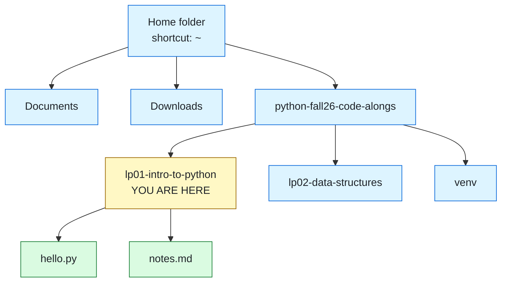
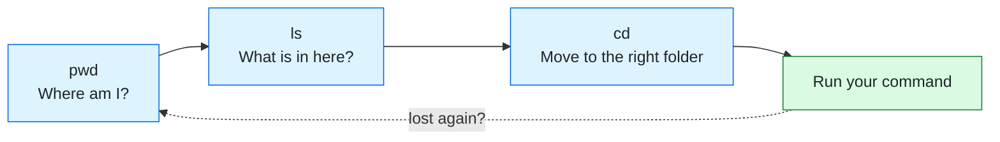
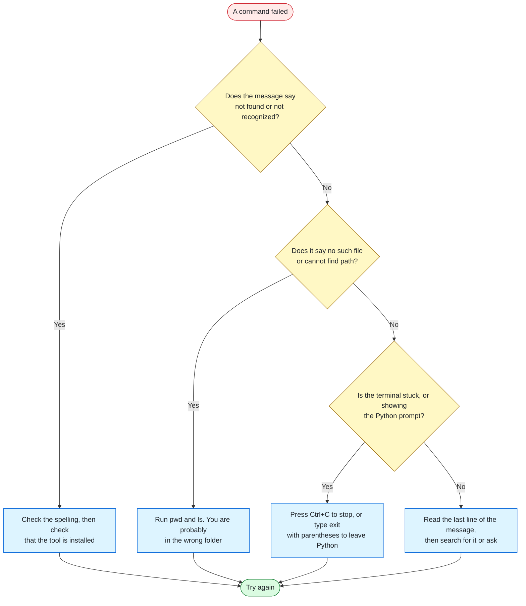

# Command Line Basics

The terminal survival guide for Code the Dream's Intro to Python. About a dozen commands cover nearly everything this class will ask of you, and this page walks through each one.

[🏠 Back to the main README](../README.md) · [🌿 Next up: Git Commands](git-commands.md)

> [!NOTE]
> Practicing the commands on this page will not hurt your computer. The one command that deserves real caution is `rm`, and it gets its own section: [Handle With Care](#handle-with-care).

## Contents

- [Why Use a Terminal](#why-use-a-terminal)
- [Anatomy of a Command](#anatomy-of-a-command)
- [Folders and Paths](#folders-and-paths)
- [The Look, Move, Act Loop](#the-look-move-act-loop)
- [The Essential Commands](#the-essential-commands)
- [Guided Walkthrough](#guided-walkthrough)
- [Running Python From the Terminal](#running-python-from-the-terminal)
- [Keyboard Shortcuts](#keyboard-shortcuts)
- [Naming Rules](#naming-rules)
- [Handle With Care](#handle-with-care)
- [When Things Go Wrong](#when-things-go-wrong)
- [Practice Missions](#practice-missions)
- [Quick Reference Card](#quick-reference-card)

## Why Use a Terminal

Clicking through folders with a mouse is like ordering by pointing at the pictures on a menu: friendly, but limited to what is printed. The terminal is talking straight to the kitchen. You say exactly what you want, you get exactly that, and you can order things the menu never listed.

In this class, the terminal is where you will:

- Run your Python files
- Turn your virtual environment on and off
- Install packages with `pip`
- Save and share your work with Git

Every one of those tools was built to be typed. That is why developers spend so much time here, and why a little comfort with the terminal pays off in every lesson that follows.

### Which terminal should I open?

| Your computer | Open this | Follow this column in the tables below |
|---------------|-----------|----------------------------------------|
| Windows | PowerShell | **Windows PowerShell** |
| macOS | Terminal (it runs a shell called zsh) | **macOS, Linux, Git Bash** |
| Linux | Terminal (it runs a shell called bash) | **macOS, Linux, Git Bash** |
| Windows, using Git Bash | Git Bash (installed along with Git) | **macOS, Linux, Git Bash** |

The easiest way to open one on any computer: open Visual Studio Code, then choose **Terminal**, then **New Terminal** from the top menu. A panel opens at the bottom of the window, already pointed at whatever folder you have open.

<details>
<summary>📖 Terminal, shell, command line: what is the difference?</summary>

| Word | What it means |
|------|---------------|
| **Terminal** | The window you type into |
| **Shell** | The program inside that window that reads your commands and runs them |
| **Command line** | The general idea of controlling a computer by typing instead of clicking |
| **Prompt** | The text waiting at the start of the line, telling you the shell is ready |
| **PowerShell** | The default shell on Windows |
| **zsh** and **bash** | The default shells on macOS and Linux |
| **Git Bash** | A bash shell for Windows that installs along with Git |

In everyday conversation, people use the first three words to mean the same thing. You can too.

</details>

## Anatomy of a Command

A command is a short sentence with a strict word order: the tool comes first, the details come after, and spaces separate the pieces.

```text
python   --version
  │          │
  │          └── option (also called a flag): adjusts what the program does
  └───────────── program: the tool you are calling


python   hello.py
  │          │
  │          └── argument: the thing the program should act on
  └───────────── program: the tool you are calling
```

Three rules cover almost everything:

1. **Nothing happens until you press <kbd>Enter</kbd>.** Type the command, check it, then send it.
2. **Spelling and spacing are exact.** `python--version` and `python --version` are different commands, and only one of them works.
3. **Silence usually means success.** Many commands print nothing when they work. If you get your prompt back with no complaint, the job is done.

> [!TIP]
> Tutorials often show a `$` or `PS>` at the start of a command. That symbol is the prompt, not part of the command. Type only what comes after it.

## Folders and Paths

Your files live in folders, and folders live inside other folders, like a family tree. The terminal is always "standing" in exactly one folder, called the **working directory**. Think of it as your character's position on a game map: every command you run happens where you are standing.



*The files shown are examples. Your folders will have their own contents.*

A **path** is the address of a file or folder. There are two ways to write one:

| Kind | What it is | Example from the map above |
|------|------------|----------------------------|
| **Absolute path** | The full street address, starting from the top of the computer. It works no matter where you are standing. | `/Users/you/python-fall26-code-alongs/lp01-intro-to-python/hello.py` |
| **Relative path** | Directions from where you are standing right now. Shorter, but it depends on your position. | `hello.py` |

On Windows the same absolute path looks like `C:\Users\you\python-fall26-code-alongs\lp01-intro-to-python\hello.py`. Windows draws its slashes backward, but PowerShell accepts either direction.

Four shortcuts save a great deal of typing:

| Shortcut | Means | Example |
|----------|-------|---------|
| `.` | The folder you are in right now | `code .` opens the current folder in VS Code |
| `..` | The folder one level up (the parent) | `cd ..` moves from `lp01-intro-to-python` up to `python-fall26-code-alongs` |
| `~` | Your home folder | `cd ~` takes you home from anywhere |
| `../other` | Up one level, then into a neighbor | `cd ../lp02-data-structures` hops sideways to the next lesson |

> 🧓 **Dad joke drop:** Why did the folder break up with the file? It needed more space. *(That is also the reason we never put spaces in file names. See [Naming Rules](#naming-rules).)*

## The Look, Move, Act Loop

Most beginner terminal errors have one cause: running the right command in the wrong folder. The cure is a habit. Before you act, look around.



Those three commands are the heart of this page, so here is each one up close.

### `pwd`: where am I?

Short for "print working directory." It prints the absolute path of the folder you are standing in.

```bash
pwd
```

```text
/Users/you/python-fall26-code-alongs
```

PowerShell prints the same answer with a small header above it, starting with `C:\Users\`.

### `ls`: what is in here?

Short for "list." It shows the files and folders inside your working directory.

```bash
ls
```

```text
LICENSE    README.md    lp01-intro-to-python    venv
```

PowerShell shows the same items as a table with extra columns for dates and sizes. More detail, same information.

### `cd`: move somewhere else

Short for "change directory." Give it the name of a folder you can see with `ls`, and you step inside.

```bash
cd lp01-intro-to-python
```

`cd` prints nothing when it works. Your prompt changes to show the new folder, and you can run `pwd` to confirm the move.

> [!TIP]
> Feeling lost is normal and fixable. Run `pwd`, then `ls`. Those two commands answer "where am I?" and "what can I reach from here?" every single time.

## The Essential Commands

Good news for Windows users: PowerShell understands most of the same short commands as macOS and Linux. The table marks the few places where they differ.

| Goal | macOS, Linux, Git Bash | Windows PowerShell | Good to know |
|------|------------------------|--------------------|--------------|
| Show where you are | `pwd` | `pwd` | Prints your working directory |
| List what is here | `ls` | `ls` | Run it often |
| List hidden files too | `ls -a` | `ls -Force` | Reveals names starting with a dot, like `.gitignore` |
| Go into a folder | `cd folder-name` | `cd folder-name` | The folder must be visible in `ls` |
| Go up one level | `cd ..` | `cd ..` | Two dots mean "the parent folder" |
| Go to your home folder | `cd ~` | `cd ~` | Works from anywhere |
| Make a new folder | `mkdir folder-name` | `mkdir folder-name` | Short for "make directory" |
| Make an empty file | `touch hello.py` | `New-Item hello.py` | **Different on Windows** |
| Open a file in VS Code | `code hello.py` | `code hello.py` | Creates the file if it does not exist yet |
| Open this whole folder in VS Code | `code .` | `code .` | The dot means "right here" |
| Print a file's contents | `cat hello.py` | `cat hello.py` | Quick peek without opening an editor |
| Copy a file | `cp hello.py backup.py` | `cp hello.py backup.py` | Original first, copy second |
| Rename or move a file | `mv old.py new.py` | `mv old.py new.py` | Renaming and moving are the same action |
| Delete a file | `rm hello.py` | `rm hello.py` | **No recycle bin.** Read [Handle With Care](#handle-with-care) |
| Delete a folder and its contents | `rm -r folder-name` | `rm -r folder-name` | **No recycle bin, and it takes everything inside** |
| Clear the screen | `clear` | `clear` | Deletes nothing, only tidies the view |
| Open this folder in the file browser | `open .` (macOS) | `explorer .` | Handy for seeing the terminal and the mouse world side by side |
| Check your Python version | `python3 --version` | `python --version` | **Different on Windows** |
| Run a Python file | `python3 hello.py` | `python hello.py` | **Different on Windows** |

<details>
<summary>🐍 Why is it <code>python</code> in one place and <code>python3</code> in another?</summary>

For historical reasons, macOS and Linux reserve the name `python3` for modern Python, while the Windows installer registers it as `python` (and also as `py`).

Once your virtual environment is active and your prompt starts with `(venv)`, plain `python` works on every system. That is one more reason to activate it at the start of each session. Setup steps are in the [main README](../README.md#getting-started).

</details>

<details>
<summary>🧰 The <code>code</code> command is not found on macOS</summary>

Open Visual Studio Code, press <kbd>Cmd</kbd> + <kbd>Shift</kbd> + <kbd>P</kbd>, type `shell command`, and choose **Shell Command: Install 'code' command in PATH**. Close and reopen your terminal, then try again.

</details>

## Guided Walkthrough

Time to drive. This takes about ten minutes and builds a practice folder you can safely delete afterward. Type each command yourself instead of pasting it. Your fingers learn things your eyes skip.

**1. Find out where you are.**

```bash
pwd
```

You should see the path of whatever folder your terminal opened in.

**2. Go home.**

```bash
cd ~
```

Nothing prints. Run `pwd` again and you should see your home folder, such as `/Users/you` or `C:\Users\you`.

**3. Make a practice folder.**

```bash
mkdir cli-practice
```

macOS and Linux print nothing. PowerShell prints a small table confirming the new folder. Both mean success.

**4. Step inside it.**

```bash
cd cli-practice
```

Your prompt should now mention `cli-practice`.

**5. Create an empty Python file.** This is one of the few commands that differs by system.

macOS, Linux, or Git Bash:

```bash
touch hello.py
```

Windows PowerShell:

```powershell
New-Item hello.py
```

**6. Confirm the file exists.**

```bash
ls
```

You should see `hello.py` in the list.

**7. Open the file in your editor and give it one line of code.**

```bash
code hello.py
```

In the editor, type the line below, then save with <kbd>Ctrl</kbd> + <kbd>S</kbd> (Windows, Linux) or <kbd>Cmd</kbd> + <kbd>S</kbd> (macOS).

```python
print("Hello from the command line!")
```

**8. Run it.**

macOS, Linux, or Git Bash:

```bash
python3 hello.py
```

Windows PowerShell:

```powershell
python hello.py
```

You should see:

```text
Hello from the command line!
```

**9. Peek at the file without opening the editor.**

```bash
cat hello.py
```

The terminal prints your one line of code back to you.

**10. Step back out.**

```bash
cd ..
```

You are home again, and `cli-practice` is one of the folders `ls` will show you.

That is the entire job in miniature: move to the right folder, make a file, run it. Everything else on this page is a variation on those ten steps.

## Running Python From the Terminal

There are two ways to run Python, and beginners often land in the second one by accident.

| You type | What happens | When to use it |
|----------|--------------|----------------|
| `python hello.py` | Python runs the whole file from top to bottom, then hands the terminal back | Almost always. This is how you run your work |
| `python` (nothing after it) | Python opens **interactive mode** and waits for you to type Python code one line at a time | Quick experiments, like checking what `7 // 2` gives you |

*(On macOS and Linux outside a virtual environment, type `python3` in both cases.)*

### Read your prompt

The prompt tells you who is listening. Shell commands only work in the shell, and Python code only works in Python.

| Your prompt looks like | Who is listening | What it understands |
|------------------------|------------------|---------------------|
| `PS C:\Users\you>` | PowerShell | Commands such as `cd`, `ls`, `git`, `python` |
| `you@computer ~ %` or a line ending in `$` | zsh or bash | Commands such as `cd`, `ls`, `git`, `python3` |
| `(venv)` at the very start | Your shell, with the virtual environment active | Everything above, using this project's packages |
| `>>>` | Python interactive mode | Python code only. `cd` and `ls` will fail here |
| `In [1]:` | An IPython console, such as the one built into Spyder | Python code. It is not a system terminal, so open a real one for the commands on this page |

If you see `>>>` and wanted your normal terminal back, type `exit()` and press <kbd>Enter</kbd>.

> 🧓 **Dad joke drop:** My terminal and I have an honest relationship. I tell it what I want, and it tells me "command not found."

## Keyboard Shortcuts

Professionals look fast in a terminal because they type less, not because they type quickly.

| Keys | What it does | Why it matters |
|------|--------------|----------------|
| <kbd>Tab</kbd> | Finishes a file or folder name for you | Type `cd lp01` then press <kbd>Tab</kbd>. If the name completes, it exists. If nothing happens, you have a typo or you are in the wrong folder. It is a spell checker and a time saver in one key |
| <kbd>↑</kbd> and <kbd>↓</kbd> | Scroll through commands you already ran | Rerun or fix your last command without retyping it |
| <kbd>Ctrl</kbd> + <kbd>C</kbd> | Stops whatever is currently running | The universal escape hatch for a frozen terminal or a runaway loop. Yes, it is <kbd>Ctrl</kbd> on a Mac too |
| `clear` | Wipes the screen | A clean view when the scrollback gets noisy. Nothing is deleted |
| `exit()` | Leaves Python interactive mode | Gets you from `>>>` back to your shell |

Copying and pasting works with <kbd>Ctrl</kbd> + <kbd>V</kbd> (Windows) or <kbd>Cmd</kbd> + <kbd>V</kbd> (macOS) in the VS Code terminal. In Git Bash, paste with <kbd>Shift</kbd> + <kbd>Insert</kbd>.

## Naming Rules

The terminal splits commands apart at every space, so a file named `my homework.py` looks like two separate things: `my` and `homework.py`. A few naming habits prevent a whole category of errors.

| Rule | Instead of | Use | Why |
|------|------------|-----|-----|
| No spaces | `my homework.py` | `my_homework.py` | Spaces separate arguments. Names with spaces must be wrapped in quotes every time |
| Lowercase | `Hello.PY` | `hello.py` | Some systems treat `Hello.py` and `hello.py` as different files, and some do not. Lowercase everywhere removes the question |
| Underscores for Python files | `data-cleaner.py` | `data_cleaner.py` | Python can only `import` file names made of letters, numbers, and underscores |
| Never borrow a library's name | `random.py`, `math.py`, `pandas.py` | `random_practice.py` | Python looks in your folder first. A file named `random.py` hides the real `random` module, and the error message will not make that obvious |

If you must use a name with spaces, wrap it in quotes: `cd "My Folder"`.

## Handle With Care

The terminal trusts you completely. It does not ask "are you sure?" and it does not keep a recycle bin.

> [!WARNING]
> `rm` deletes permanently. `rm -r` permanently deletes a folder **and everything inside it**. There is no undo.

Four habits keep you safe:

1. **Look before you delete.** Run `pwd` and `ls` first, every time, so you know exactly where you are and what is there.
2. **Name the target precisely.** Delete one specific file or folder by name. Leave wildcard patterns such as `*` alone until you know what they match.
3. **Understand before you paste.** If a website tells you to run a command you cannot explain, look it up or ask first. That goes double for anything containing `sudo`, which runs a command with full administrator power.
4. **Commit your work with Git.** Committed work can be recovered even after a bad `rm`. See the [Git Commands](git-commands.md) page.

## When Things Go Wrong

Error messages are not the terminal being angry. They are the terminal being specific. Follow the path:



<details>
<summary>🛠️ Common messages and what they really mean</summary>

| The terminal says | What it means | What to do |
|-------------------|---------------|------------|
| `command not found` or `is not recognized as the name of a cmdlet` | The shell does not know that word | Check for typos. If the tool was installed a moment ago, close and reopen the terminal. For `python`, try `python3` or `py` |
| `No such file or directory` or `Cannot find path` | The file or folder is not where you said it is | Run `pwd` and `ls`. Use <kbd>Tab</kbd> to complete the name so typos are impossible |
| `can't open file 'hello.py': [Errno 2] No such file or directory` | Python itself is working. It cannot find your file in this folder | `cd` into the folder that holds the file, then run it again |
| `Permission denied` | You tried to change something outside your own folders | Check `pwd`. Class work belongs inside your home folder. Do not reach for `sudo` to force it |
| `SyntaxError` after typing `cd` or `ls` | You are inside Python interactive mode, and Python does not speak shell | Type `exit()` and press <kbd>Enter</kbd> |
| A lone `>` or `>>` and nothing happens | The shell thinks your command is unfinished, usually because of an unclosed quote | Press <kbd>Ctrl</kbd> + <kbd>C</kbd> and type the command again |
| Nothing at all, and no prompt | A program is still running or waiting for input | Press <kbd>Ctrl</kbd> + <kbd>C</kbd> |
| PowerShell says running scripts is disabled | Windows is blocking the virtual environment activation script | See the fix in the [main README](../README.md#getting-started) |

</details>

Still stuck? Copy the exact message, note what you typed and what you expected, and bring all three to your cohort channel or to Monday night.

## Practice Missions

Reading about commands does about as much for you as reading about push-ups. Try each mission before opening its solution.

### Mission 1: Scavenger hunt

Using only the terminal, answer these three questions:

1. What is the absolute path of your home folder?
2. How many items are inside it?
3. What hidden files live inside your copy of the class repository?

<details>
<summary>✅ Solution</summary>

```bash
cd ~
pwd
ls
cd python-fall26-code-alongs
```

Then list hidden files. macOS, Linux, or Git Bash:

```bash
ls -a
```

Windows PowerShell:

```powershell
ls -Force
```

You should spot `.gitignore` and a `.git` folder. If `cd python-fall26-code-alongs` fails, you cloned the repository somewhere other than your home folder. Use `ls` and `cd` to track it down, which is good practice in itself.

</details>

### Mission 2: Build a folder tree

Starting from your home folder, build this structure without touching the mouse:

```text
terminal-gym/
├── code/
│   └── hello.py
└── notes/
    └── week1.txt
```

<details>
<summary>✅ Solution</summary>

macOS, Linux, or Git Bash:

```bash
cd ~
mkdir terminal-gym
cd terminal-gym
mkdir code
mkdir notes
touch code/hello.py
touch notes/week1.txt
ls code
ls notes
```

Windows PowerShell:

```powershell
cd ~
mkdir terminal-gym
cd terminal-gym
mkdir code
mkdir notes
New-Item code/hello.py
New-Item notes/week1.txt
ls code
ls notes
```

Notice the relative paths: `code/hello.py` means "inside the `code` folder that is inside the folder I am standing in."

</details>

### Mission 3: Rename, copy, clean up

Inside `terminal-gym`:

1. Rename `hello.py` to `greet.py`.
2. Put a copy of `greet.py` in the `notes` folder.
3. Leave `terminal-gym`, then delete the whole thing.

<details>
<summary>✅ Solution</summary>

These commands are the same on every system:

```bash
mv code/hello.py code/greet.py
cp code/greet.py notes/greet.py
ls notes
cd ..
pwd
ls
rm -r terminal-gym
```

Notice the `pwd` and `ls` right before the `rm -r`. That is the "look before you delete" habit in action. The same steps will remove the `cli-practice` folder from the walkthrough when you are done with it.

</details>

## Quick Reference Card

```text
LOOK
  pwd                     where am I?
  ls                      what is here?

MOVE
  cd folder-name          go into a folder
  cd ..                   go up one level
  cd ~                    go home

MAKE
  mkdir folder-name       new folder
  touch file.py           new file (macOS, Linux, Git Bash)
  New-Item file.py        new file (Windows PowerShell)
  code file.py            open or create a file in VS Code

MANAGE
  cat file.py             print a file
  cp original copy        copy
  mv old new              rename or move
  rm file.py              delete a file (permanent)
  rm -r folder-name       delete a folder (permanent)

PYTHON
  python file.py          run a file (python3 on macOS and Linux)
  exit()                  leave the >>> prompt

RESCUE
  Ctrl + C                stop what is running
  Tab                     finish a name for me
  Up arrow                bring back my last command
  clear                   tidy the screen
```

---

**Comfortable moving around? Good.** The next skill is saving your work so that nothing is ever truly lost.

[🌿 Continue to Git Commands](git-commands.md) · [🏠 Main README](../README.md) · [🎮 Practice site](https://straydogsyn.github.io/Python-Essentials-Bridge-The-Dream/)
