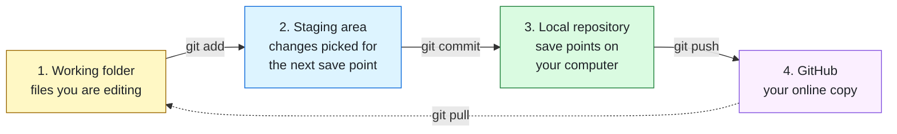
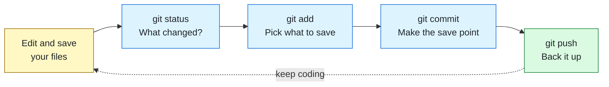
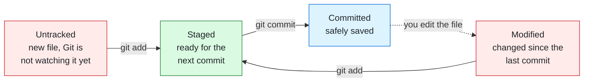
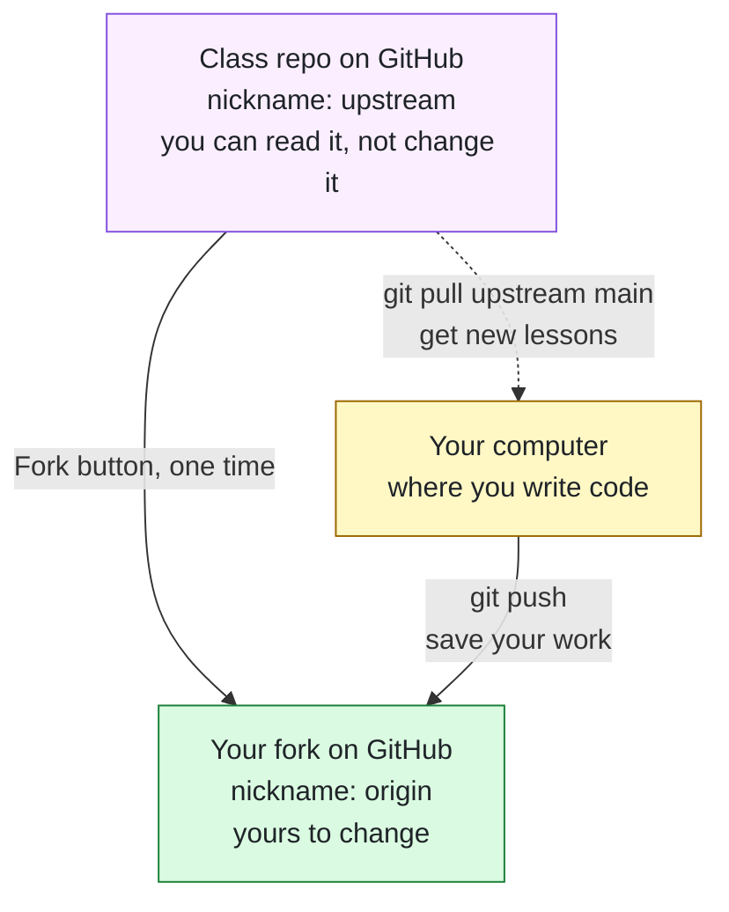
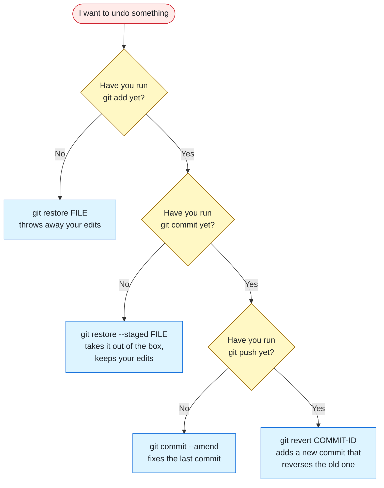
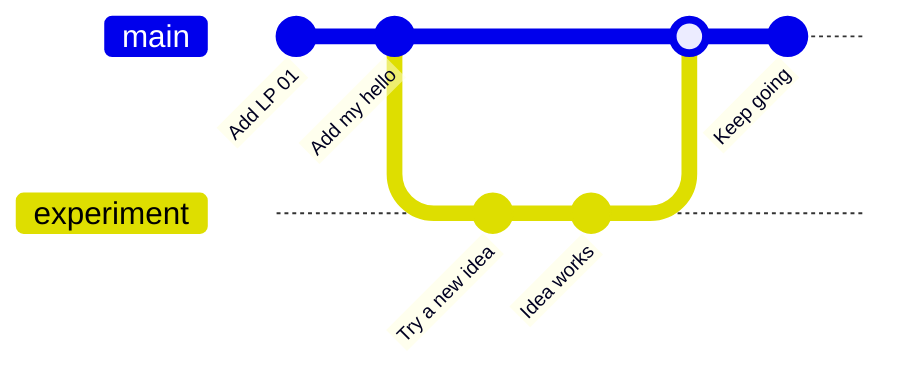
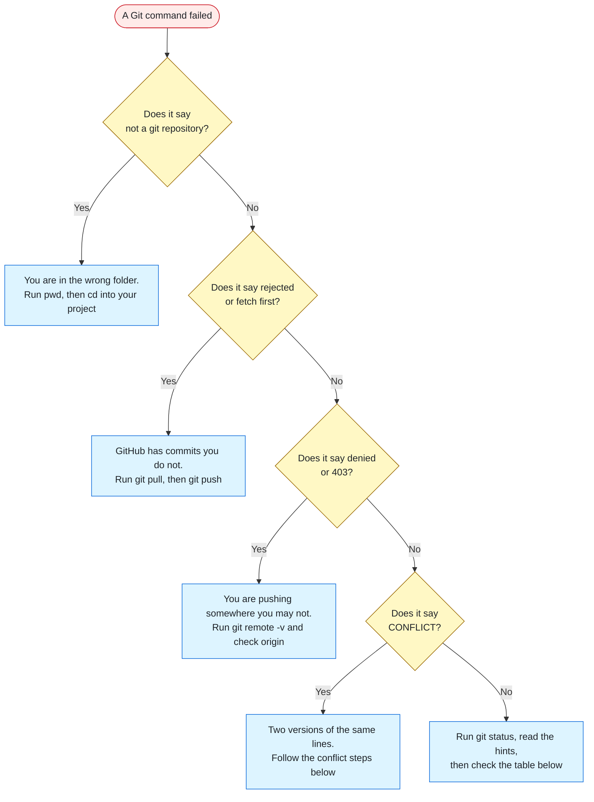

# Git Commands

The Git survival guide for Code the Dream's Intro to Python. Git has hundreds of commands. You need about a dozen, and four of them do most of the work.

[🏠 Back to the main README](../README.md) · [🖥️ Previous: Command Line Basics](command-line-basics.md)

> [!NOTE]
> Every Git command is typed in a terminal, from inside your project folder. If `cd`, `ls`, and `pwd` are new to you, spend ten minutes with [Command Line Basics](command-line-basics.md) first. This page will make far more sense afterward.

## Contents

- [What Git Is](#what-git-is)
- [One-Time Setup](#one-time-setup)
- [The Big Picture](#the-big-picture)
- [The Daily Loop](#the-daily-loop)
- [Reading git status](#reading-git-status)
- [Writing Good Commit Messages](#writing-good-commit-messages)
- [Your Fork and the Class Repo](#your-fork-and-the-class-repo)
- [Getting Each Week's New Code](#getting-each-weeks-new-code)
- [Looking Back](#looking-back)
- [The Undo Guide](#the-undo-guide)
- [Files Git Should Ignore](#files-git-should-ignore)
- [Branches](#branches)
- [When Things Go Wrong](#when-things-go-wrong)
- [Practice Missions](#practice-missions)
- [Quick Reference Card](#quick-reference-card)

## What Git Is

Git is a save system for your code. Think of the save points in a video game: before the boss fight, you save. If the fight goes badly, you reload and try again, and nothing is lost. A Git **commit** is that save point. Each one is a snapshot of your whole project at a moment in time, with a note saying what changed.

That gives you three things a regular "Save" button never will:

- **A history.** Every save point is kept, so you can see what your code looked like last Tuesday.
- **A safety net.** Break something? Go back to the last version that worked.
- **A way to share.** Send your save points to GitHub, and your work is backed up and visible to mentors, classmates, and future employers.

### Git and GitHub are two different things

| | Git | GitHub |
|---|-----|--------|
| **What it is** | A program on your computer | A website |
| **What it does** | Records save points for a project | Stores a copy of your project online |
| **Works offline?** | Yes | No |
| **90s translation** | The memory card | The friend's house you bring the memory card to |

You can use Git without GitHub. In this class you will use both: Git to save your work, and GitHub to back it up and share it.

<details>
<summary>📖 Vocabulary you will hear on Monday nights</summary>

| Word | Plain meaning |
|------|---------------|
| **Repository** (repo) | A project folder that Git is tracking |
| **Commit** | A save point: a snapshot of your project plus a short message |
| **Staging area** | The waiting room where you collect changes for your next commit |
| **Remote** | A copy of the repository that lives somewhere else, usually GitHub |
| **origin** | The nickname for the remote you push your own work to |
| **upstream** | The nickname for the original repository your fork was copied from |
| **Clone** | Download a repository from GitHub to your computer |
| **Fork** | Make your own copy of someone else's repository, on GitHub |
| **Push** | Upload your commits to GitHub |
| **Pull** | Download new commits from GitHub and combine them with yours |
| **Branch** | A separate line of save points, for trying an idea without touching the main one |
| **main** | The default branch, and the only one you need for most of this class |

</details>

## One-Time Setup

Do this once per computer. Git will remember it.

**1. Confirm Git is installed.**

```bash
git --version
```

You should see something like `git version 2.43.0`. If the command is not found, install [Git](https://git-scm.com/downloads), then close and reopen your terminal.

**2. Tell Git who you are.** Every commit is signed with a name and an email, so Git refuses to save until it has both. Use the email attached to your GitHub account, so GitHub links your commits to your profile.

```bash
git config --global user.name "Your Name"
git config --global user.email "you@example.com"
```

**3. Set three defaults that prevent common beginner headaches.**

```bash
git config --global init.defaultBranch main
git config --global pull.rebase false
git config --global core.editor "code --wait"
```

| Setting | Why you want it |
|---------|-----------------|
| `init.defaultBranch main` | Names the first branch `main` in every new repository, matching GitHub |
| `pull.rebase false` | Tells Git to combine downloaded work with yours in the simplest way. Without it, some pulls stop with an error and ask you to choose |
| `core.editor "code --wait"` | When Git needs you to type a longer message, it opens Visual Studio Code instead of Vim, an editor famous for trapping newcomers. This needs the `code` command to work in your terminal. If it does not, see the fix in [Command Line Basics](command-line-basics.md#the-essential-commands) |

**4. Check your work.**

```bash
git config --global --list
```

You should see your name, your email, and the three settings above.

<details>
<summary>🔑 Signing in to GitHub from the terminal</summary>

The first time you push, Git has to prove to GitHub that you are you. GitHub does not accept your account password in the terminal, so there is a sign-in step.

| Your computer | What to do |
|---------------|------------|
| **Windows** | Nothing extra. Git for Windows includes Git Credential Manager. A browser window opens on your first push. Sign in, approve, and Git remembers you |
| **macOS or Linux** | Install the [GitHub CLI](https://cli.github.com/), run `gh auth login`, choose **HTTPS**, and answer **Y** when asked whether to authenticate Git with your GitHub credentials |

GitHub's own walkthrough is here: [Caching your GitHub credentials in Git](https://docs.github.com/en/get-started/git-basics/caching-your-github-credentials-in-git).

</details>

## The Big Picture

Most Git confusion disappears once you know that your code can be in **four places**, and that each core command moves it one step along.



Picture mailing a package:

| Place | Package analogy | Command that moves work here |
|-------|-----------------|------------------------------|
| **Working folder** | Items spread across your desk | You, saving a file in your editor |
| **Staging area** | Items you have placed in the open box | `git add` |
| **Local repository** | The box, taped shut and labeled | `git commit` |
| **GitHub** | The box, delivered to the warehouse | `git push` |

**Why is there a staging area at all?** Because you do not always want to save everything at once. If you fixed a bug *and* started a new exercise, the staging area lets you box those up as two separate, clearly labeled save points instead of one mystery box.

> [!IMPORTANT]
> A commit lives only on your computer until you push. If your laptop meets a cup of coffee before you push, GitHub knows nothing about that work.

## The Daily Loop

This is the routine you will repeat every time you code. Four commands, always in this order.



### `git status`: what changed?

The single most useful Git command. It changes nothing and is always safe to run. It tells you which files are new, which are modified, and which are ready to commit.

```bash
git status
```

Run it before and after every other Git command until the rhythm feels natural. It also tells you what to type next, which is covered in [Reading git status](#reading-git-status).

### `git add`: pick what to save

Moves changes into the staging area.

```bash
git add my-work/hello_mine.py
```

To stage everything that changed in the current folder and below:

```bash
git add .
```

`git add` prints nothing when it works. Run `git status` to see your files move into the "Changes to be committed" group.

> [!TIP]
> `git add .` is convenient, and it stages *everything*, including files you may not have meant to share. Glance at `git status` first so there are no surprises in the box.

### `git commit`: make the save point

Seals the staged changes into a permanent snapshot with a message.

```bash
git commit -m "Add my version of the hello script"
```

```text
[main 28926b2] Add my version of the hello script
 1 file changed, 1 insertion(+)
 create mode 100644 my-work/hello_mine.py
```

The `-m` stands for "message," and the text in quotes is the label on your save point. The short code `28926b2` is the commit's unique ID. Yours will be different.

### `git push`: back it up

Uploads your new commits to GitHub.

```bash
git push
```

```text
To https://github.com/YOUR-USERNAME/python-fall26-code-alongs.git
   7dfaf2c..28926b2  main -> main
```

Refresh your repository page on GitHub and your work is there.

> 🧓 **Dad joke drop:** Why do programmers make such loyal friends? They are not afraid to commit. *(Pushing, on the other hand, they forget constantly.)*

## Reading git status

`git status` sorts your files into groups. Learn the three group headings and you can read any status message Git prints.



| Heading in `git status` | Color | What it means | What to do |
|-------------------------|-------|---------------|------------|
| `Untracked files` | Red | A new file Git has never seen | `git add` it if you want it saved |
| `Changes not staged for commit` | Red | A tracked file you edited | `git add` it to include the edit in your next commit |
| `Changes to be committed` | Green | Staged and waiting | `git commit` to save |
| `nothing to commit, working tree clean` | None | Everything is saved | Keep coding, or `git push` |

Here is a real status message with one edited file:

```text
On branch main
Your branch is ahead of 'origin/main' by 1 commit.
  (use "git push" to publish your local commits)

Changes not staged for commit:
  (use "git add <file>..." to update what will be committed)
  (use "git restore <file>..." to discard changes in working directory)
	modified:   my-work/hello_mine.py

no changes added to commit (use "git add" and/or "git commit -a")
```

Read it from the top:

1. **`On branch main`** tells you which branch you are on.
2. **`ahead of 'origin/main' by 1 commit`** means you have one save point that GitHub does not have yet. Git even tells you the fix: `git push`.
3. **`modified: my-work/hello_mine.py`** is the file you changed, listed under a heading that says it is not staged.
4. **The lines in parentheses are hints.** Git is telling you the exact command for each thing you might want to do next.

> [!TIP]
> When you do not know what to do next in Git, run `git status` and read the hints in parentheses. Git is one of the few tools that writes its own cheat sheet into its output.

## Writing Good Commit Messages

A commit message is a note to the person who reads this history later. That person is usually you, in three weeks, with no memory of tonight.

**The formula:** start with an action word, and say what the commit does. A good message completes the sentence "If applied, this commit will..."

| Instead of | Write | Why |
|------------|-------|-----|
| `stuff` | `Add temperature converter function` | Says what was added |
| `fixed it` | `Fix off-by-one error in the grade loop` | Says what was broken |
| `asdfgh` | `Add LP 02 list practice exercises` | Future you can find it |
| `final version REAL final v2` | `Rename variables for clarity in quiz script` | Git already keeps the versions, so the message can describe the change |

Three habits to build:

1. **Commit small and often.** One idea per commit. "Add the function" and "Fix the typo in the README" are two commits, not one.
2. **Commit working code.** A save point right before the boss fight is useful. A save point halfway through falling off a cliff is not.
3. **Keep it under about 50 characters** when you can. Short messages stay readable in `git log --oneline`.

## Your Fork and the Class Repo

The class repository belongs to your instructor, so you can read it and you cannot push to it. To save your own work on GitHub, you need your own copy. That copy is called a **fork**.

Once you have a fork, three repositories are in play:



A **remote** is a nickname for a repository address, so you do not have to type the full web address every time. By convention, `origin` is the one you push to and `upstream` is the original you copied from.

Pick the path that matches where you are. Both end in the same place.

<details>
<summary>🅰️ Path A: I already cloned the class repo (the main README's Getting Started steps)</summary>

Your computer currently knows only the class repo, under the nickname `origin`. You will rename that nickname to `upstream` and then add your fork as the new `origin`.

**1. Create your fork.** Open the [class repository](https://github.com/StrayDogSyn/python-fall26-code-alongs) on GitHub, click **Fork** near the top right, then **Create fork**.

**2. In your terminal, move into your project folder.**

```bash
cd python-fall26-code-alongs
```

**3. Rename the class repo's nickname.**

```bash
git remote rename origin upstream
```

**4. Add your fork as `origin`.** Replace `YOUR-USERNAME` with your GitHub username.

```bash
git remote add origin https://github.com/YOUR-USERNAME/python-fall26-code-alongs.git
```

**5. Push, and tell Git that your fork is the default destination from now on.**

```bash
git push -u origin main
```

The `-u` is a one-time flag that links your local `main` to your fork. After this, a plain `git push` is all you need.

</details>

<details>
<summary>🅱️ Path B: I am starting fresh</summary>

**1. Create your fork.** Open the [class repository](https://github.com/StrayDogSyn/python-fall26-code-alongs) on GitHub, click **Fork** near the top right, then **Create fork**.

**2. Clone your fork** (not the class repo). Replace `YOUR-USERNAME` with your GitHub username.

```bash
git clone https://github.com/YOUR-USERNAME/python-fall26-code-alongs.git
cd python-fall26-code-alongs
```

Cloning sets up the `origin` nickname for you.

**3. Add the class repo as `upstream`.**

```bash
git remote add upstream https://github.com/StrayDogSyn/python-fall26-code-alongs.git
```

Then finish the virtual environment steps in the [main README](../README.md#getting-started).

</details>

### Confirm your remotes

Whichever path you took, check the result:

```bash
git remote -v
```

```text
origin    https://github.com/YOUR-USERNAME/python-fall26-code-alongs.git (fetch)
origin    https://github.com/YOUR-USERNAME/python-fall26-code-alongs.git (push)
upstream  https://github.com/StrayDogSyn/python-fall26-code-alongs.git (fetch)
upstream  https://github.com/StrayDogSyn/python-fall26-code-alongs.git (push)
```

Two nicknames, with your username on the `origin` lines. You are set up for the rest of the course.

## Getting Each Week's New Code

New lesson folders land in the class repo after each Monday session. Bring them into your copy in three steps.

**1. Save your own work first.** Git will not combine new code with unsaved changes.

```bash
git status
git add .
git commit -m "Save my LP 01 practice before syncing"
```

If `git status` already says `working tree clean`, skip straight to step 2.

**2. Pull the new code from the class repo.**

```bash
git pull upstream main
```

Git downloads the new commits and combines them with yours. If Visual Studio Code opens a tab with a message that starts with `Merge branch 'main'`, that is Git asking you to confirm the note for this save point. Close the tab and the pull finishes.

**3. Send the combined result to your fork.**

```bash
git push
```

<details>
<summary>🖱️ Prefer buttons? Sync from the GitHub website instead</summary>

1. Open **your fork** on GitHub.
2. Above the list of files, open the **Sync fork** menu and click **Update branch**.
3. Back in your terminal, run `git pull` to bring those updates down to your computer.

Both routes end in the same place. The terminal route is worth practicing because it works for every repository, everywhere.

</details>

### Keep your work in your own lane

A **merge conflict** happens when you and the class repo both change the same lines of the same file, and Git cannot decide whose version wins. You can avoid nearly all of them with one habit:

> [!TIP]
> Leave the instructor's files as they are, and write your own versions in separate files. A folder of your own at the top of the repository, such as `my-work/`, is a simple way to do it. The class repo never touches that folder, so weekly updates slide in without a fight.

This fits how the code-alongs are meant to be used anyway: write your version first, then compare it with the finished one.

## Looking Back

Three commands let you read your history without changing anything.

### `git log --oneline`: list your save points

```bash
git log --oneline
```

```text
28926b2 Add my version of the hello script
7dfaf2c Add LP 01
```

Newest first. Each line is a commit ID and its message. If the list is long, Git shows it one screen at a time: press <kbd>Space</kbd> for the next screen and <kbd>q</kbd> to quit.

### `git diff`: what did I change?

Shows the exact lines you changed since your last commit, before you stage them.

```bash
git diff
```

Git prints a few header lines naming the file, then the changes themselves:

```diff
 print("mine")
+print("again")
```

Lines starting with `+` were added. Lines starting with `-` were removed. Press <kbd>q</kbd> to exit if the output fills the screen.

### `git diff --staged`: what am I about to commit?

Same idea, for changes you have already staged with `git add`. It is a last look in the box before you tape it shut.

```bash
git diff --staged
```

## The Undo Guide

Everyone needs an undo button. Git has several, and the right one depends on how far the mistake has traveled.



| Situation | Command | What happens |
|-----------|---------|--------------|
| I edited a file and want the last committed version back | `git restore hello_mine.py` | Your uncommitted edits to that file are discarded. **This one cannot be undone** |
| I staged a file by mistake | `git restore --staged hello_mine.py` | The file leaves the staging area. Your edits stay exactly as they are |
| I made a typo in my last commit message, and I have not pushed | `git commit --amend -m "Better message"` | The last commit gets the new message |
| I forgot a file in my last commit, and I have not pushed | `git add forgotten.py` then `git commit --amend --no-edit` | The file joins the last commit, and the message stays the same |
| I pushed a commit that broke something | `git revert COMMIT-ID` | Git creates a new commit that reverses the old one. History stays honest, and nobody else's copy breaks |

Find the `COMMIT-ID` with `git log --oneline`. It is the short code at the start of each line.

> [!WARNING]
> You will eventually see advice online recommending `git reset --hard` or `git push --force`. Both can permanently destroy work, yours or someone else's. Until you know exactly what they do, treat them like a stranger's command with `sudo` in it: ask before you run it.

> 🧓 **Dad joke drop:** Be kind, rewind. Git is the only VCR that lets you do it without returning the tape.

## Files Git Should Ignore

Some files do not belong in a repository. A file named `.gitignore`, sitting in the top folder of your project, lists the files and folders Git should pretend not to see.

| Leave out | Why |
|-----------|-----|
| `venv/` | Your virtual environment holds thousands of files that anyone can rebuild with one command. It is also specific to your computer |
| `__pycache__/` | Python creates these speed-up files automatically. They are clutter |
| `.env` | By convention, this file holds passwords and secret keys. A secret pushed to a public repository should be treated as stolen |
| `.DS_Store` | A housekeeping file macOS drops into folders. Nobody needs it |

A `.gitignore` is plain text, one pattern per line:

```gitignore
venv/
__pycache__/
.env
.DS_Store
```

The class repository already includes a `.gitignore`. When you start your own projects, create one before your first commit.

> [!WARNING]
> `.gitignore` only works on files Git is not tracking yet. If you already committed a secret, adding it to `.gitignore` afterward does not remove it from your history. Change the password or key right away, then ask for help cleaning up.

## Branches

*Optional for the first few weeks. Come back when you want to experiment without risking code that works.*

A branch is a parallel line of save points. You can try a risky idea on a branch, and `main` stays untouched until you decide the idea is good.



| Goal | Command |
|------|---------|
| See which branch you are on | `git branch` |
| Create a new branch and switch to it | `git switch -c experiment` |
| Switch back to main | `git switch main` |
| Bring the experiment's commits into main | `git merge experiment` (run it while on `main`) |
| Delete a branch you are finished with | `git branch -d experiment` |

Older tutorials use `git checkout` for switching branches. It still works. `git switch` is the newer command that does one job with a clearer name.

## When Things Go Wrong

Git error messages look intimidating and are usually specific. Find the key phrase, then follow the path.



<details>
<summary>🛠️ Common messages and what they really mean</summary>

| Git says | What it means | What to do |
|----------|---------------|------------|
| `fatal: not a git repository` | You are not inside a project folder Git is tracking | Run `pwd`, then `cd` into your project |
| `Author identity unknown` or `Please tell me who you are` | Git does not have your name and email | Run the two `git config` commands in [One-Time Setup](#one-time-setup) |
| `nothing to commit, working tree clean` | There is nothing new to save | If you expected changes, save the file in your editor first, then check `git status` |
| `nothing added to commit but untracked files present` | You have new files and have not staged them | Run `git add`, then commit again |
| `Permission ... denied` or `error: 403` when pushing | You are pushing to a repository you do not own, usually the class repo | Run `git remote -v`. If `origin` does not show your username, follow Path A in [Your Fork and the Class Repo](#your-fork-and-the-class-repo) |
| `! [rejected]` with `fetch first` or `non-fast-forward` | GitHub has commits your computer does not | Run `git pull`, then `git push` |
| `Your local changes to the following files would be overwritten by merge` | You have unsaved work that the pull would run over | Commit your work first, then pull again |
| `Need to specify how to reconcile divergent branches` | Git wants to know how to combine two histories | Run `git config --global pull.rebase false`, then pull again |
| `remote origin already exists` | You tried to add a nickname that is already taken | Run `git remote -v` to see it. To change its address: `git remote set-url origin NEW-ADDRESS` |
| `src refspec main does not match any` | There is no `main` branch with commits to push | Make at least one commit. If `git branch` shows `master`, run `git branch -M main` |
| `Support for password authentication was removed` | GitHub will not accept your account password in the terminal | Follow the sign-in steps in [One-Time Setup](#one-time-setup) |
| `LF will be replaced by CRLF` | Windows and macOS mark the ends of lines differently, and Git is translating | Nothing. It is a notice, not an error |
| A screen full of `~` symbols and nothing you type works | Git opened the Vim editor for a message | Press <kbd>Esc</kbd>, type `:wq`, press <kbd>Enter</kbd>. Then set VS Code as your editor in [One-Time Setup](#one-time-setup) |

</details>

<details>
<summary>⚔️ How to resolve a merge conflict</summary>

When Git cannot combine two versions of the same lines, it stops and marks the spot inside the file:

```text
<<<<<<< HEAD
print("Hello from my version")
=======
print("Hello from the class repo")
>>>>>>> upstream/main
```

Everything between `<<<<<<<` and `=======` is your version. Everything between `=======` and `>>>>>>>` is the incoming version.

1. Run `git status`. The conflicted files are listed under `Unmerged paths`.
2. Open each one in Visual Studio Code. Above each conflict you will see clickable choices such as **Accept Current Change** and **Accept Incoming Change**. Pick one, or edit by hand until the code reads the way you want.
3. Make sure every `<<<<<<<`, `=======`, and `>>>>>>>` line is gone, then save the file.
4. Stage and commit the result:

```bash
git add .
git commit -m "Resolve merge conflict in hello.py"
```

Changed your mind partway through? `git merge --abort` puts everything back the way it was before the pull.

</details>

Still stuck? Run `git status`, copy the full output along with the command you ran, and bring both to your cohort channel or to Monday night. More general debugging steps are in [Getting Unstuck](../README.md#getting-unstuck).

## Practice Missions

These missions use a throwaway folder in your home directory, so there is no way to damage your class work. Try each one before opening its solution.

### Mission 1: Your first three commits

1. Create a folder named `git-practice` in your home folder and turn it into a repository with `git init`.
2. Create a file named `notes.txt`, put one line of text in it, and commit it.
3. Add a second line and commit again. Then add a third line and commit a third time.
4. List your three save points on one line each.

<details>
<summary>✅ Solution</summary>

```bash
cd ~
mkdir git-practice
cd git-practice
git init
code notes.txt
```

Type a line in the editor, save, and come back to the terminal.

```bash
git status
git add notes.txt
git commit -m "Add notes file"
```

Add a second line in the editor, save, then:

```bash
git add notes.txt
git commit -m "Add second note"
```

Add a third line, save, then:

```bash
git add notes.txt
git commit -m "Add third note"
git log --oneline
```

You should see three lines, newest on top. Notice there is no `git push` here: this repository lives only on your computer, which is perfectly fine for practice.

</details>

### Mission 2: Three kinds of undo

Still inside `git-practice`:

1. Add a line of nonsense to `notes.txt` and save. Before staging it, throw the change away.
2. Add a new line and save. Stage it, then change your mind and unstage it. Confirm your edit is still in the file.
3. Stage and commit that line with the message `Udpate notse`. Then fix the typo in the message without making a new commit.

<details>
<summary>✅ Solution</summary>

**Part 1: discard an edit.**

```bash
git status
git restore notes.txt
git status
```

The nonsense line is gone, and the status is clean.

**Part 2: unstage.**

```bash
git add notes.txt
git status
git restore --staged notes.txt
git status
```

The file moves from the green "to be committed" group back to the red "not staged" group. Open it and your edit is still there.

**Part 3: fix the last message.**

```bash
git add notes.txt
git commit -m "Udpate notse"
git commit --amend -m "Update notes"
git log --oneline
```

The typo is gone from the history. This is safe because the commit was never pushed.

</details>

### Mission 3: The full round trip

In your real class project this time:

1. Confirm you have both an `origin` and an `upstream` remote.
2. Create a `my-work` folder with a file named `hello_mine.py` that prints a greeting.
3. Run the full daily loop and find your file on GitHub.
4. Pull the latest code from the class repo.

<details>
<summary>✅ Solution</summary>

```bash
cd ~/python-fall26-code-alongs
git remote -v
```

If you only see `origin`, follow [Your Fork and the Class Repo](#your-fork-and-the-class-repo) first. Then:

```bash
mkdir my-work
code my-work/hello_mine.py
```

Type `print("Hello from my fork!")` in the editor, save, and return to the terminal.

```bash
git status
git add my-work/hello_mine.py
git commit -m "Add my first practice file"
git push
```

Open your fork on GitHub and click into `my-work`. Your file is there, with your commit message next to it.

```bash
git pull upstream main
git push
```

If Git says `Already up to date`, there is nothing new this week and you are finished. If your project folder lives somewhere other than your home folder, adjust the first `cd` to match.

</details>

When you are done practicing, delete the `git-practice` folder from your file browser. It is the simplest way to remove a repository, because the hidden `.git` folder inside it contains read-only files that make `rm -r` ask extra questions.

## Quick Reference Card

```text
SETUP (once per computer)
  git config --global user.name "Your Name"
  git config --global user.email "you@example.com"

START
  git clone ADDRESS            download a repository
  git init                     turn this folder into a repository

THE DAILY LOOP
  git status                   what changed?
  git add FILE                 stage one file
  git add .                    stage everything here
  git commit -m "Message"      make the save point
  git push                     upload to GitHub

STAY IN SYNC
  git pull                     get updates from your fork
  git pull upstream main       get new lessons from the class repo
  git remote -v                show my remotes

LOOK BACK
  git log --oneline            list save points
  git diff                     show unstaged changes
  git diff --staged            show what is about to be committed

UNDO
  git restore FILE             discard edits (permanent)
  git restore --staged FILE    unstage, keep edits
  git commit --amend -m "..."  fix the last commit (before pushing)
  git revert COMMIT-ID         reverse a pushed commit safely

ESCAPE HATCHES
  q                            leave a long log or diff
  Esc  :wq  Enter              leave Vim
  git merge --abort            cancel a merge in progress
```

---

**Save early, save often, push before you close the laptop.** The students who commit after every small win are the ones who never lose a night's work.

[🖥️ Command Line Basics](command-line-basics.md) · [🏠 Main README](../README.md) · [🎮 Practice site](https://straydogsyn.github.io/Python-Essentials-Bridge-The-Dream/)
